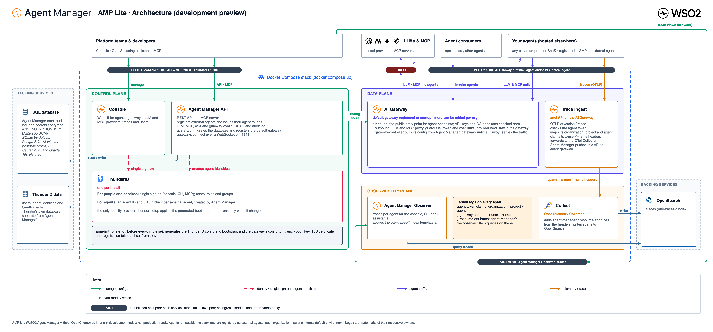

# WSO2 Agent Manager

[](https://goreportcard.com/report/github.com/wso2/agent-manager/agent-manager-service)
[](https://github.com/wso2/agent-manager/releases?q=amp)
[](https://github.com/wso2/agent-manager/releases?q=amp-instrumentation)

An open control plane for enterprises to register, govern and observe AI agents.

## Overview

WSO2 Agent Manager provides a platform for enterprise AI agent management. Organizations register the AI agents they run, govern how those agents reach models, tools and other agents, and trace what they do.

This branch is **AMP Lite**, a development preview of Agent Manager without OpenChoreo. Lite connects external agents only: agents run wherever you host them and are registered in AMP, which issues their identities, fronts their traffic through the AI Gateway and collects their traces. Each organization has one internal `default` environment that the console and API never show. Hosted agents (builds and deployments) and evaluations are deferred; their API routes answer `501 Not Implemented`. Lite is not production-ready.

## Architecture



- [Database schema](docs/amp-lite/database-schema.md) and [data model diagram](docs/amp-lite/data-model.png)
- Editable sources (draw.io, HTML and generators): [docs/amp-lite](docs/amp-lite/README.md)

## Key Features

- **External Agents** - Register agents hosted anywhere and manage their configuration from one control plane
- **Agent Identity** - Give every agent its own identity and OAuth client in ThunderID
- **AI Gateway** - Route agent traffic and LLM, MCP and A2A calls through a gateway with API keys, OAuth, guardrails and rate limits
- **Governance** - Enforce policies and access controls with role-based permissions and an audit log
- **Tracing** - Capture OpenTelemetry traces per organization, project and agent, and browse them in the console
- **Auto-Instrumentation** - OpenTelemetry-based instrumentation for AI frameworks with zero code changes

## Components

| Component | Description |
|-----------|-------------|
| **amp-console** ([console](console)) | Web-based management console for the platform |
| **amp-api** ([agent-manager-service](agent-manager-service)) | Backend API and MCP server powering the control plane |
| **amp-observer** ([agent-manager-observer](agent-manager-observer)) | API for querying trace data in OpenSearch |
| **amctl** ([cli](cli)) | Command-line client for the Agent Manager API |
| **amp-instrumentation** ([libs/amp-instrumentation](libs/amp-instrumentation)) | Python auto-instrumentation package for AI frameworks |
| **amp-evaluation** ([libs/amp-evaluation](libs/amp-evaluation)) | Python library for scoring agent traces (evaluations are deferred in Lite) |

## Deployment

AMP Lite runs on Docker Compose; there is no Kubernetes or Helm. [deployments/standalone](deployments/standalone) holds the stack: ThunderID, the Agent Manager API, console and observer, the AI Gateway (controller and runtime), and OpenSearch with an OpenTelemetry collector for traces. Each release attaches the same files as `wso2-agent-manager-standalone-<version>.tar.gz`, pinned to that release's images.

## Getting Started

Run AMP Lite from this checkout with Docker:

```bash
make up
```

This builds the images and starts the stack; the console is at http://localhost:3000 and the API at http://localhost:9000 (sign in as `admin`, password `THUNDER_ADMIN_PASSWORD` in `deployments/standalone/.env`). For development, `make dev-up` runs the API from source with hot reload and the console with Vite. Run `make help` for the rest.

For the released Agent Manager, which runs on OpenChoreo, see the [Quick Start Guide](https://wso2.com/agent-platform/docs/latest/get-started/quick-start/).

## Contributing

We welcome contributions from the community! Here's how you can help:

1. **Report Issues** - Found a bug or have a feature request? Open an issue on GitHub
2. **Submit Pull Requests** - Fork the repository, make your changes, and submit a PR
3. **Improve Documentation** - Help us improve docs, tutorials, and examples

Please ensure your contributions adhere to our coding standards and include appropriate tests.

## License

This project is licensed under the Apache License 2.0 - see the [LICENSE](LICENSE) file for details.

## Support

- **Issues**: [GitHub Issues](https://github.com/wso2/agent-manager/issues)
- **Community**: [WSO2 Community](https://wso2.com/community/)

---
(c) Copyright 2012 - 2026 [WSO2 LLC](https://wso2.com/).
