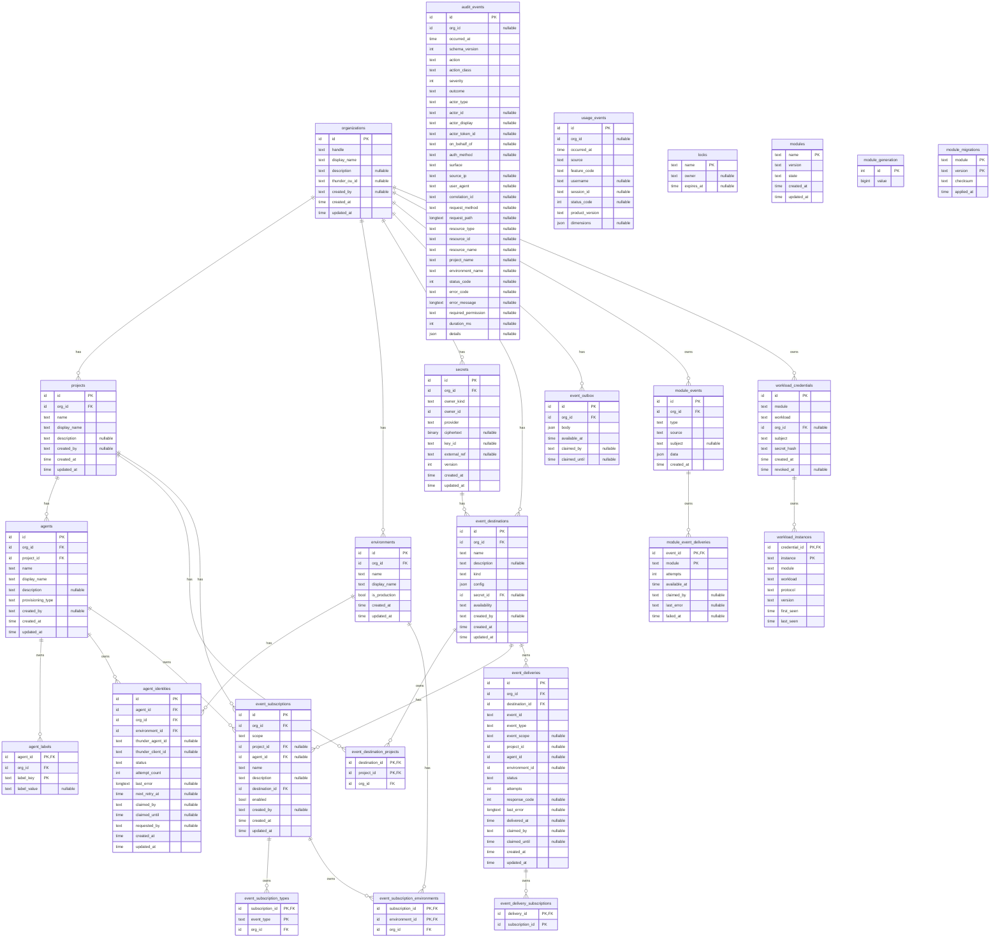

# Database ER diagram

Core tables of AMP Lite, rendered from [`db_migrations/schema/lite.yaml`](../db_migrations/schema/lite.yaml) by `docs/amp-lite/src/er_gen.py` (run through `docs/amp-lite/src/render.sh`). "owns" means the child is deleted with its parent.

Module tables (`mod_<module>_<table>`, such as the AI Gateway's), column rules and decisions are in the [AMP Lite database schema](../../docs/amp-lite/database-schema.md).

