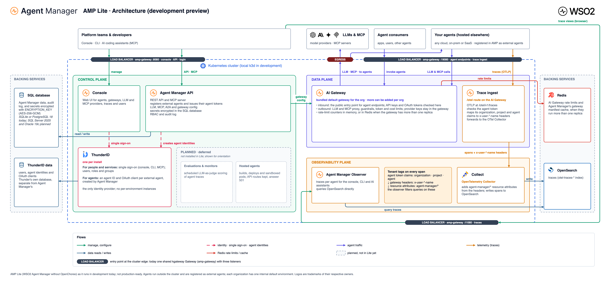
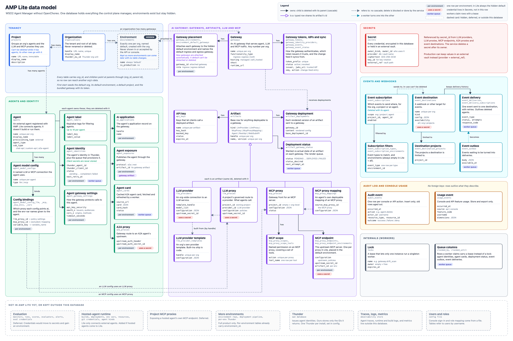

# AMP Lite design

AMP Lite is WSO2 Agent Manager without OpenChoreo: external agents only, one hidden `default` environment per organization, and one database as the source of truth. It is a development preview and not production-ready.

| File | What it is |
|---|---|
| [database-schema.md](database-schema.md) | Target database schema, rules and decisions |
| [architecture.png](architecture.png) | Architecture diagram |
| [architecture.drawio](architecture.drawio) | Same diagram, editable in draw.io / diagrams.net |
| [architecture.html](architecture.html) | HTML render of the architecture diagram |
| [data-model.png](data-model.png) | Data model in plain language: main tables, what they hold and how they relate |
| [data-model.html](data-model.html) | HTML render of the data model |
| [src/](src) | Generators for all of the above |





## Editing the diagrams

The diagrams are generated, so edit the generators and re-render:

- `src/architecture_gen.py` writes `architecture.drawio` and `architecture.html` from one layout; logos come from `src/logos.json`.
- `src/data_model_gen.py` writes `data-model.html`.
- `src/render.sh` runs both and takes the PNGs with headless Chrome (set `CHROME` if it is not at the macOS default path).

```bash
docs/amp-lite/src/render.sh
```

A quick change can also be made in `architecture.drawio` directly, but the next `render.sh` run overwrites it, so carry the change into the generator too.
