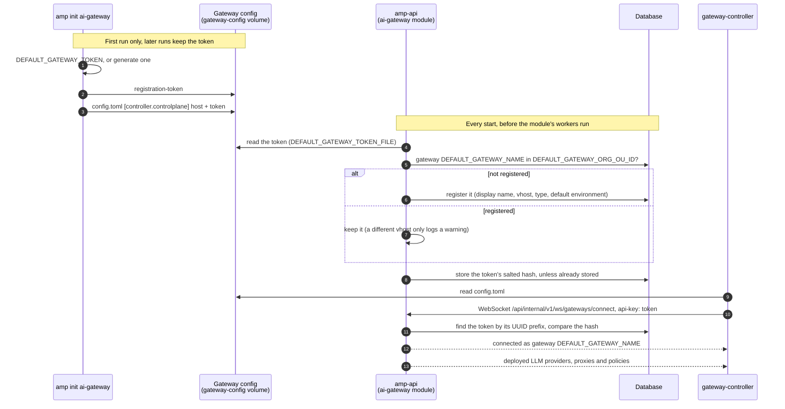

# The AI Gateway module

The `ai-gateway` module (`modules/aigateway`) is the largest module in this repository and the reference for most of the contract in [Writing a module](modules.md). This page covers what is particular to it: how far it runs on the contract, its settings, and how the gateway that ships with Agent Manager registers itself.

## Where the gateway stands

The `ai-gateway` module (`modules/aigateway`) runs on the contract alone; its non-test packages import no core package. Where it still differs (its controllers' fixed internal paths, its first activation) is noted below.

What it already does as a module:

- **Permissions:** its 42 permissions are its own (`ai-gateway:<resource>.<action>`, such as `ai-gateway:llm-providers.read` and `ai-gateway:deploy.production`), declared in its manifest and rendered into ThunderID as the `ai-gateway` resource.
- **API:** `Activate` mounts its public API with `rt.Handle` under `/m/ai-gateway`. LLM providers (`/llm-providers`, with their API keys, deployment history, consumers and policies), LLM provider templates (`/llm-provider-templates`), MCP proxies (`/mcp-proxies`), gateways (`/gateways`, with their tokens, health and identity providers; only a self-hosted gateway can be registered, edited or removed, and it goes in the organization's default environment), identity providers (`/identity-providers`) and agents (`/agents/{agentName}/...?project=`) take the organization from the access token, and the resources among them serve documents; the other routes keep `/orgs/{orgName}/...`, which the core resolves the organization from. The API is described by its own document, `modules/aigateway/api/openapi.yaml`, with Go types in `gwspec` and an amctl client in `cli/pkg/clients/aigateway`. The console calls it through `GATEWAY_BASE` in `libs/api-client`.
- **Agent routes use the default environment:** the agent routes carry no environment (the `/environments/{envID}` and `/environments/{envName}` segments were dropped), so keys, the agent card, the A2A proxy, deploy settings and config keys all act on the organization's default environment, and their audit records and events name it. Bringing environments back to these routes would be another breaking path change.
- **Controller API:** the routes its gateway controllers call, and their WebSocket, stay at `/api/internal/v1/...` with the controllers' `api-key` header, mounted with `rt.HandleInternalAt` until the controllers can register as workloads ([#2493](https://github.com/wso2/agent-manager/issues/2493)).
- **Tables:** its 33 tables are `mod_ai_gateway_*`, created by its own migrations, with no foreign keys into core; its finalize hooks clean up after agents, projects and environments ([database-schema.md](database-schema.md#gateway-module-tables)).
- **Credentials:** the upstream credentials it keeps (LLM provider and proxy upstream auth, including the key minted on a provider for a proxy, MCP proxy endpoint auth and A2A proxy auth) are in `rt.Secrets()`, not in its rows; the core's vault seals them. A row's configuration carries the path as its `secretRef`; the value is written and deleted in the row's own transaction with `Secrets().In(tx)`, so a rolled-back create leaves no secret, and responses never carry it. Paths (`gwsecret`) are named after the owning row: `llm-providers/<id>/upstream-auth`, `llm-proxies/<id>/upstream-auth`, `a2a-proxies/<id>/upstream-auth` and `mcp-proxies/<proxy id>/endpoints/<handle hash>/upstream-auth` (an update re-creates a proxy's endpoints, so the endpoint's handle names it). A row's credential goes with the row, including in the agent teardown, the environment finalize hook and an agent artifact's delete. The controller-facing routes read them with the organization of the artifact they serve, since those requests carry no caller organization.
- **Provider placement is declared:** an LLM provider is deployed and undeployed through `spec.gateways` on its create or update. The only deployment routes left are `GET /llm-providers/{providerId}/deployments` (the history) and `POST .../deployments/restore` (a rollback). A create or update raises `ai-gateway.llm_provider.deployed` for each gateway it newly placed the provider on and `ai-gateway.llm_provider.undeployed` for each it took it off, with `modkit.EmitAlso`.
- **Agent bindings:** an agent create or update carries the agent's LLM providers and MCP proxies as `spec.extensions.ai-gateway` (`{modelConfig, mcpConfig, settings}`). The validate hook checks them, and the apply hook stores them as `pending` bindings in the agent's transaction. The `agent.created` event (and, on update, the module's own `ai-gateway.agent.bindings_changed`) then provisions each binding in the background: a retried, idempotent handler creates its LLM or MCP configuration, adopting one an earlier attempt already made, and marks it `ready`, or `failed` with the last error while it keeps retrying. `GET /m/ai-gateway/agents/{agentName}/configurations?project={projName}` returns the settings and each binding's state. Deleting the agent records a teardown in its transaction; the `agent.deleted` handler revokes and undeploys whatever was provisioned, pending bindings included, and retries until it is done. Until then a new agent with the same name is refused with 409.
- **Audit and webhooks:** its routes declare their audit actions (`ai-gateway:<resource>.<verb>`, such as `ai-gateway:api-keys.rotate`) and webhook events (`ai-gateway.<type>`, such as `ai-gateway.llm_provider.created`) with `modkit.Audit`, `AuditCoalesce`, `AuditFailClosed` and `Emits`; the manifest declares them with their detail keys (`gwaudit`). Key, token, trust and A2A-proxy routes are fail-closed, and its handlers name what they acted on with `AuditResource` and `AuditDetail`.

- **Lifecycle:** `Activate` builds the gateway on `rt.DB()`, `rt.Logger()`, `rt.Core()` and its settings the first time it runs on a replica, and reuses that gateway on later activations while the module stays active, so a change to another module keeps its controller connections. Building writes nothing. One worker, `gateway`, first registers the default gateway (idempotent, so it runs on every start), then runs its A2A card reconciler, deployment timeout sweeper and reconcile worker; when the module is disabled or the server stops, it stops them, closes the controllers' WebSockets and its event hub, and the next activation builds a new gateway. A controller that connects before the default gateway is registered is refused and retries. This first activation does more than register, against the rule above: building the gateway's services is not cheap, though it has no side effects.
- **Switching it off:** `amp` installs it by default; `amp module disable ai-gateway` turns it off at runtime on every replica. Its routes (public and the controllers' fixed internal paths) answer 404, its hooks, capabilities, MCP tools, permissions and pages go, its workers stop, and every replica closes its controllers' WebSockets; its data stays. `enable` brings it back, and controllers reconnect and resync. An agent create carrying `extensions.ai-gateway` while it is off is a 400. Known limitation until controllers register as workloads ([#2493](https://github.com/wso2/agent-manager/issues/2493)): a released controller treats the 404 as permanent, exits, and Docker restarts it in a loop while it is off, and the gateway runtime keeps serving its last configuration; after `enable`, its next restart connects and resyncs.
- **No environment attach offer:** the proposal's one-click "attach a gateway" offer on `environment.created` is not built. In Lite an organization has one environment, created on its first request, and a gateway serves exactly one environment; the default gateway is attached to the trial organization's environment, and other organizations (including an identity provider's) add a gateway for theirs. Revisit if Lite gains more environments per organization.
- **Workloads and health:** its manifest declares the `gateway-controller` workload (a trusted service, not required, protocol `amp-gateway/v1`). Released controllers send no heartbeat yet ([#2493](https://github.com/wso2/agent-manager/issues/2493)), so no instance is listed, and the module is never degraded for lack of one. Its `Health` reports each registered gateway's connection from the gateway table (connected, and since when), which the replica holding the gateway's WebSocket keeps current, so every replica and `amp module health ai-gateway` give the same answer; it adds the platform gateway failure summary. "ok, no gateway connected" is a healthy state. Revoking a gateway token publishes `gateway_token.revoked` on that gateway's event stream (the gateway's own event hub, which reaches whichever replica holds its WebSocket, unlike a module event, which one replica claims); that replica closes the socket if it authenticated with the token, and the controller's reconnect is then refused. The event is never sent to the controller.
- **MCP tools:** its 11 tools are registered with `rt.MCPTool` from `Activate` (`gwmcp`), so they leave `/mcp` with the module, and the MCP endpoint's protected-resource metadata lists their scopes only while it is active.
- **Agent identity:** its agent-identity pages and MCP proxy scopes reach the environment's directory through the core's `identity.directory/v1`, not a ThunderID client of their own.
- **Settings:** its settings are module settings, `MODULE_AI_GATEWAY_<KEY>` (or the `config:` block of its `modules:` entry), loaded and checked by `gwconfig`:

  | Keys | What they set |
  |---|---|
  | `DEFAULT_GATEWAY_NAME`, `_DISPLAY_NAME`, `_VHOST`, `_TYPE`, `_ORG_OU_ID`, `_TOKEN`, `_TOKEN_FILE` | The gateway registered when the module activates (Compose sets the bundled one), in the trial organization file sign-in names (`00000000-0000-0000-0000-000000000001`) unless `_ORG_OU_ID` names another. The default does not follow the core's `DEFAULT_ORG_OU_ID`: if you change the trial organization, set `_ORG_OU_ID` to the same id. An empty name registers none. |
  | `A2A_CARD_FETCH_DIAL_ADDR` | The `host:port` platform agent-card fetches dial instead of the card URL's host. |
  | `MANIFEST_CACHE_BACKEND` (`memory` or `redis`), `MANIFEST_CACHE_REDIS_HOST`, `_PORT`, `_PASSWORD`, `_DB`, `_TLS_ENABLED` | Where gateway-reported policy manifests are cached; use `redis` with more than one replica. |
  | `WEBSOCKET_MAX_CONNECTIONS`, `WEBSOCKET_CONNECTION_TIMEOUT`, `WEBSOCKET_RATE_LIMIT_PER_MIN` | Limits on gateway controller connections. |
  | `DEPLOYMENT_TIMEOUT_SECONDS`, `DEPLOYMENT_TIMEOUT_SWEEP_INTERVAL_SECONDS` | When an unacknowledged deploy or undeploy fails. |
  | `RECONCILE_RENDER_INTERVAL_SECONDS`, `_PLACE_INTERVAL_SECONDS`, `_DRIFT_INTERVAL_SECONDS`, `_RENDER_LEASE_SECONDS`, `_RENDER_ATTEMPT_BUDGET` | The reconcile worker. |
  | `FAILURE_THRESHOLD_SECONDS`, `FAILURE_MAX_AGE_SECONDS`, `FAILURE_PERCENTAGE_THRESHOLD` | The platform gateway failure summary. |
  | `AGENT_CORS_ALLOWED_ORIGIN`, `_METHODS`, `_HEADERS`, `AGENT_CORS_ALLOW_CREDENTIALS` | The CORS policy agents' gateway routes get by default. |

  `amp init ai-gateway DIR` reads its own keys from the same place: `CONTROLPLANE_HOST`, `ADMIN_PASSWORD`, `AMP_JWKS_URL`, `THUNDER_ISSUER`, `THUNDER_JWKS_URL`, `HOST`, `LISTENER_PORT` and `FILE_OWNER` for the controller's `config.toml`, and `DEFAULT_GATEWAY_TOKEN` as the registration token it writes (it generates and keeps one when unset). `THUNDER_ISSUER` and `THUNDER_JWKS_URL` are optional but go together: they seed the `ThunderKeyManager` key manager, which trusts the platform identity provider's tokens. Without them the gateway trusts no platform identity provider, so Agent Identity on MCP proxies is unavailable there, as on any self-hosted gateway.

  Identity providers a gateway trusts for agent OAuth live in its `config.toml` (`[[policy_configurations.jwtauth_v1.keymanagers]]`), which the gateway reads at start. The identity provider routes (`/gateways/{gatewayID}/identity-providers`) keep only the module's record of them, which agent OAuth settings are checked against; the console generates the matching `config.toml` entry, which the operator adds to the gateway before restarting it.

Its write routes call `rt.Core().EnsureOrg` before the handler, so an organization's first gateway rows never precede the organization. Its test helpers (`gwtest`) use the core's test database, as module tests may.

## How the default gateway registers itself

A gateway connects to Agent Manager with a registration token: Agent Manager keeps the token's salted hash as the gateway's credential, and the gateway's controller presents the token itself. Registering a gateway by hand means creating it in the console, copying its token and putting the token into the gateway's configuration. For the gateway that runs next to Agent Manager, the module does this on its own: `amp init` creates the token and hands it to both sides, and the module registers the gateway with it when it starts. `DEFAULT_GATEWAY_NAME` turns this on; empty, nothing is registered.

1. **The token** (`gwinit`). `amp init ai-gateway DIR` uses `DEFAULT_GATEWAY_TOKEN` when it is set, and otherwise generates a token on the first run and keeps it: a UUID, a dash and 43 base64url characters, where the UUID is the prefix the token is looked up by. It writes the token to `DIR/registration-token` and into `DIR/config.toml`, next to the control plane's address (`CONTROLPLANE_HOST`). A token set later replaces the kept one.
2. **The registration** (`gwsvc.DefaultGatewaySeeder`, run by the module before its workers start). It reads the token from `DEFAULT_GATEWAY_TOKEN`, else from `DEFAULT_GATEWAY_TOKEN_FILE`, and resolves the default environment of the organization in `DEFAULT_GATEWAY_ORG_OU_ID` (the trial organization unless set; the module ensures that organization's default environment first). A gateway not yet registered under `DEFAULT_GATEWAY_NAME` is registered as a managed gateway with `DEFAULT_GATEWAY_DISPLAY_NAME`, `DEFAULT_GATEWAY_VHOST` and `DEFAULT_GATEWAY_TYPE`, attached to that environment. It then stores the token's salted hash as an active token of the gateway.
3. **The connection.** The controller opens its WebSocket at `/api/internal/v1/ws/gateways/connect` on the internal port with the token in the `api-key` header. The module finds the stored token by its prefix, checks the hash, and from then on pushes the gateway everything deployed to it. A controller that connects before step 2 is done is refused and retries; a failed step 2 restarts the module's worker with backoff.

Step 2 runs on every start and changes nothing that is already there:

| Found at start | What happens |
|---|---|
| No gateway with that name | Registered, then its token stored |
| The gateway, with another vhost | Kept as registered; a warning names both vhosts |
| The gateway, its token already stored | Nothing |
| The gateway, a new token (another prefix) | The new token is added; the old one stays active |
| A token with this prefix that belongs to another gateway, or another token | Startup fails: configure a new token |
| `DEFAULT_GATEWAY_NAME` set without a vhost and a token or token file | Settings are refused at startup |

**In the Compose stack**, `amp-init` writes the token into the `gateway-config` volume, which `amp-api` mounts read-only and the gateway reads `config.toml` from, and `docker-compose.yml` sets `DEFAULT_GATEWAY_NAME=default`, the vhost from `GATEWAY_HOST` and `GATEWAY_PORT`, and `DEFAULT_GATEWAY_TOKEN_FILE=/amp/gw/registration-token`. Nothing needs setting.

**A gateway you run yourself** registers the same way: set `MODULE_AI_GATEWAY_DEFAULT_GATEWAY_NAME`, a `MODULE_AI_GATEWAY_DEFAULT_GATEWAY_VHOST` agents can reach, and the token (`MODULE_AI_GATEWAY_DEFAULT_GATEWAY_TOKEN` or `_TOKEN_FILE`), and give the gateway controller the same token and Agent Manager's internal address. `amp init ai-gateway DIR` writes a `config.toml` with both. To register gateways in the console instead, leave the name empty.
