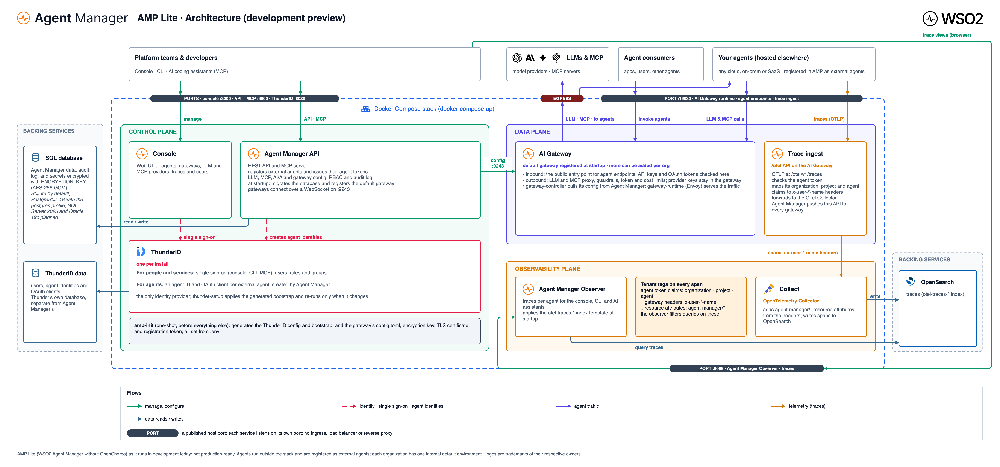

# AMP Lite user guide

How to install and run AMP Lite, register your agents and see their traces. AMP Lite is a development preview of WSO2 Agent Manager without OpenChoreo, and it is not production-ready. To work on AMP itself, see the [developer guide](developer-guide.md).

## What you get

AMP Lite runs as one Docker Compose stack. There is no Kubernetes or Helm.

| Service | What it does | Default address |
|---|---|---|
| Console | Web UI | http://localhost:3000 |
| Agent Manager API | REST API and MCP server | http://localhost:9000 |
| ThunderID | Sign-in and agent identities | http://thunder.amp.localhost:8080 |
| AI Gateway | Agent traffic, LLM and MCP calls, trace ingest | http://default-default.gateway.localhost:19080 |
| Observer | Trace queries | http://localhost:9098 |
| OpenSearch and OpenTelemetry Collector | Trace storage | internal only |

Your agents run wherever you host them. You register them in AMP, which gives each one an identity and a token. Agents send LLM, MCP and A2A calls and their traces through the AI Gateway.



## Requirements

- Docker with Compose v2: Docker Desktop, Colima or Docker Engine on Linux.
- About 2 GB of free memory for the stack. OpenSearch uses most of it.
- Free host ports: 3000, 8080, 9000, 9098, 9243 and 19080. Change them in `.env` if any are taken.
- On Linux hosts, OpenSearch needs `sudo sysctl -w vm.max_map_count=262144`. Docker Desktop and Colima already set it.

## Install

Each release attaches a Compose bundle pinned to that release's images. Replace `<version>` with the release you want:

```bash
curl -fsSLO https://github.com/wso2/agent-manager/releases/download/amp/v<version>/wso2-agent-manager-standalone-<version>.tar.gz
tar xzf wso2-agent-manager-standalone-<version>.tar.gz && cd standalone
cp .env.example .env
```

On macOS with Colima, unpack it inside your home folder. Colima shares only your home folder with its VM, so the stack can't read its files from anywhere else, such as `/tmp`.

Edit `.env` before the first start. The defaults are for local development only. Change these for anything shared:

| Setting | What to set |
|---|---|
| `AMP_ADMIN_PASSWORD` | The console admin password |
| `AMP_API_CLIENT_SECRET`, `AMP_CONSOLE_CLIENT_SECRET`, `AMP_PUBLISHER_CLIENT_SECRET`, `AMP_SYSTEM_CLIENT_SECRET` | Random strings |
| `AMP_ENCRYPTION_KEY` | 64 hex characters, from `openssl rand -hex 32`. It encrypts stored secrets; keep it safe, because data encrypted with it can't be read without it |
| `GATEWAY_ADMIN_PASSWORD`, `OPENSEARCH_PASSWORD` | Strong passwords (OpenSearch needs upper case, lower case, a digit and a symbol) |
| `AMP_DEFAULT_USERS` | Optional extra console users, as `username:password[:admin]` entries separated by commas |

Then start it:

```bash
docker compose up -d --wait
```

The first start takes a few minutes while images download and ThunderID is set up. Later starts take under a minute.

## Choose a database

AMP stores its data in SQLite by default, in the `amp-data` volume. To use PostgreSQL instead, uncomment these two lines in `.env` before the first start:

```bash
COMPOSE_PROFILES=postgres
AMP_DB_DRIVER=postgres
```

The API creates and migrates its tables on every start. Switching databases later does not copy data across.

## Sign in

Open http://localhost:3000 and sign in as `admin` with the `AMP_ADMIN_PASSWORD` from `.env`.

A new install has no projects. Create one with **Add project** before you register an agent.

### How sign-in works

`AUTH_MODE` in `.env` decides it, and the stack ships with `file`.

**`file` (the default).** The API checks the password against a user file and
issues its own tokens, so no identity provider is involved. `amp-init` writes
that file on every start, from `AMP_ADMIN_PASSWORD` and `AMP_DEFAULT_USERS`, into
a volume the API reads at `/etc/amp/users.yaml`. It is generated, not edited:
change the accounts in `.env` and restart, because anything written into the file
by hand is overwritten. Passwords are stored as bcrypt hashes; the file holds
every operator's hash, so treat it as a secret.

A session lasts 8 hours (`FILE_AUTH_TOKEN_TTL`). There is no refresh token, so
the console returns to the sign-in page when it ends rather than renewing.

#### Adding users

`AMP_DEFAULT_USERS` holds the accounts besides `admin`, comma separated, as
`username:password` or `username:password:admin`. The suffix picks the role:

```
AMP_DEFAULT_USERS=dev:dev-password, lead:lead-password:admin
```

| Entry | Role | Scopes |
| --- | --- | --- |
| `dev:dev-password` | Developer | 56 |
| `lead:lead-password:admin` | Agent Manager Admin | 105 |

Developer covers day-to-day work: full control of projects, agents and LLM
proxies, plus monitors, git secrets and the traces and logs. It can read and
connect to MCP servers and LLM providers but not create them, and it cannot
touch organization settings, identity providers, gateways, roles or groups.
Admin holds everything.

Restart after editing, because the user file is written at start-up:

```
docker compose up -d --force-recreate amp-init amp-api
```

Neither username nor password may contain a comma or a colon. The other two
roles the platform defines, AI Lead and Platform Engineer, aren't reachable from
`.env`; assign those in the console after the user first signs in.

**`idp`.** Sign-in goes to ThunderID, which is what a shared or production
deployment should use: accounts, sessions and password policy are then the
identity provider's rather than a file on the host. File mode is aimed at local
and single-operator installs.

Switching takes three settings, because the two key-set URLs default to the
API's own and do not follow `AUTH_MODE`:

```
AUTH_MODE=idp
KEY_MANAGER_JWKS_URL=http://thunder:${THUNDER_PORT}/oauth2/jwks
OBSERVER_JWKS_URL=http://thunder:${THUNDER_PORT}/oauth2/jwks
```

Set `AUTH_MODE` alone and every token is refused with a bare `401`.

ThunderID runs in both modes: agent identity uses it either way. `amctl` and the
MCP endpoints also sign in through ThunderID, so they need `AUTH_MODE=idp`.

## Register an agent and send traces

1. In the console, open a project, click **New agent**, enter a name and click **Register**.
2. The **Setup Agent** panel opens with an API key already generated, valid for 90 days. To change that, pick another **Token Duration** and click **Regenerate**. Choose your agent's language, then copy the `AMP_OTEL_ENDPOINT` and `AMP_AGENT_API_KEY` values it shows. The key is shown only once; reopen the panel later with **Set up agent** on the agent's page to generate a new one.
3. Run your agent with those two values set. For a Python agent, install [amp-instrumentation](../libs/amp-instrumentation) and start the agent through `amp-instrument`; it traces common AI frameworks with no code changes:

   ```bash
   pip install amp-instrumentation
   export AMP_OTEL_ENDPOINT="http://default-default.gateway.localhost:19080/otel"
   export AMP_AGENT_API_KEY="<key from the console>"
   amp-instrument python main.py
   ```

   Other languages send OTLP/HTTP to `<AMP_OTEL_ENDPOINT>/v1/traces` with the key in an `x-amp-api-key` header. [samples/dotnet-agent](../samples/dotnet-agent) shows one way.
4. Use the agent, then open **Traces** for that agent in the console.

The [samples](../samples) folder has ready-to-run agents, and each README walks through these steps.

## Route LLM and MCP calls through the gateway

Add LLM providers and MCP servers in the console, then attach them to an agent. The agent calls them through the AI Gateway, which checks the agent's key, applies guardrails and token or cost limits, and keeps the provider keys out of your agent.

## Command line

`amctl` is the command-line client for the Agent Manager API. See [cli](../cli).

## Everyday operations

Run these from the `standalone` folder:

| Task | Command |
|---|---|
| Stop, keeping data | `docker compose down` |
| Start again | `docker compose up -d --wait` |
| Follow logs | `docker compose logs -f` (or name a service, such as `amp-api`) |
| See what's running | `docker compose ps` |
| Delete everything, including users and data | `docker compose --profile postgres down -v` |

### Upgrade

Download and unpack the new bundle in a new folder, then copy your `.env` into it. Check the new `.env.example` for added settings, then stop the old stack and start the new one with `docker compose up -d --wait`. Keep the same `COMPOSE_PROJECT_NAME`, so the new stack uses the same data volumes. The API migrates the database on start.

When the generated ThunderID settings change, ThunderID's setup runs again. It keeps your users and data, but it resets the admin password to `AMP_ADMIN_PASSWORD`.

### Back up

The data lives in Docker volumes named after `COMPOSE_PROJECT_NAME` (default `amp-lite`): the AMP database (SQLite or PostgreSQL), ThunderID's database, the gateway's state, and OpenSearch. Stop the stack before copying them. Also keep your `.env`, especially `AMP_ENCRYPTION_KEY`.

## Troubleshooting

- **A port is already in use:** change the matching `*_PORT` setting in `.env` and start again.
- **`thunder-setup` fails with `can't open '/amp/thunder/entrypoint.sh'`:** Docker can't see the bundle's folder. On macOS with Colima, move the `standalone` folder inside your home folder.
- **`thunder.amp.localhost` or `*.gateway.localhost` doesn't resolve:** browsers resolve `*.localhost` to 127.0.0.1 themselves, but some command-line tools and agent runtimes don't. Add the names to `/etc/hosts`, or call `localhost:19080` with a `Host: default-default.gateway.localhost` header.
- **OpenSearch exits on Linux:** set `vm.max_map_count` as shown under Requirements.
- **Traces don't appear:** check that the agent's key hasn't expired, and that the agent can reach the gateway address in `AMP_OTEL_ENDPOINT`. `docker compose logs gateway-runtime otel-collector` shows rejected or failed requests.
- **Sign-in fails after an upgrade:** the admin password was reset to `AMP_ADMIN_PASSWORD` in `.env`.

## Limits of this preview

- Only external agents are supported. Hosted agents (builds and deployments) and evaluations are not available; their API routes answer `501 Not Implemented`.
- Each organization has one internal environment, which the console doesn't show.
- It is not production-ready: there is no high availability, and TLS is up to you.
- Sign-in is file-based by default, which suits local and single-operator installs. Use `AUTH_MODE=idp` for anything shared; see [How sign-in works](#how-sign-in-works).
